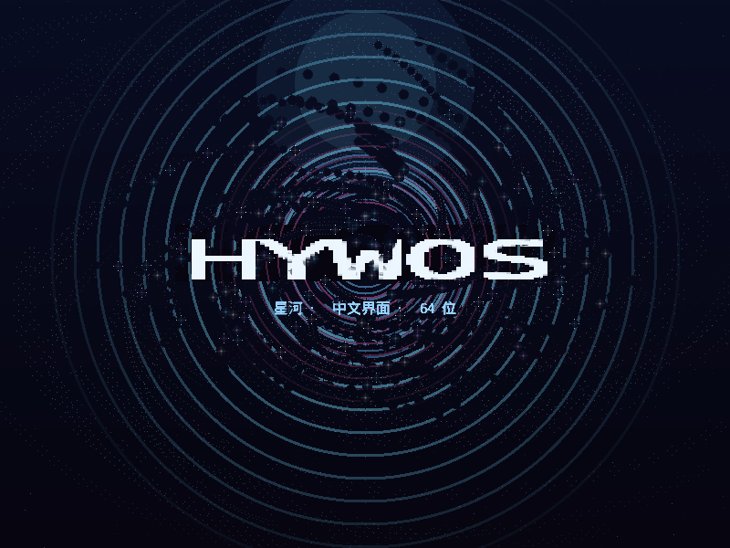
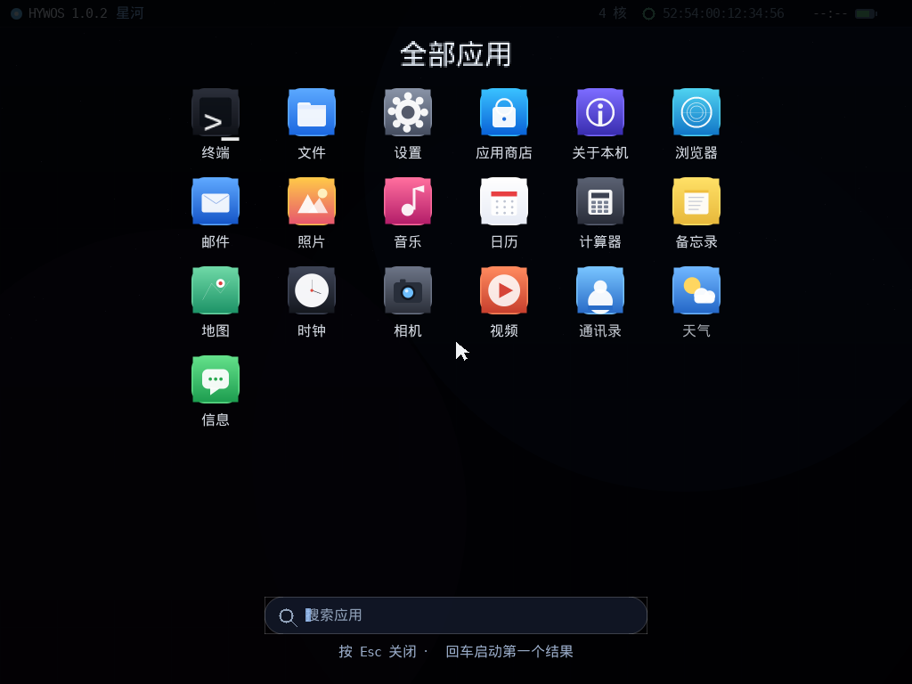

# HYWOS 1.0.2 «星河 · 驱动版»

<p align="center">
  
</p>

HYWOS 是一个用 Rust 编写的 64 位 UEFI 操作系统，不依赖任何第三方 crate，
以 `no_std` 方式直接运行在 UEFI 固件之上。1.0.2 增加了显卡、PS/2 键鼠与声卡的
寄存器级驱动，并保留 1.0.1 的完整中文界面。



## 目录

- [1.0.2 新变化](#102-新变化)
- [硬件驱动](#硬件驱动)
- [特性总览](#特性总览)
- [界面截图](#界面截图)
- [快捷键](#快捷键)
- [中文支持](#中文支持)
- [终端](#终端)
- [文件系统与应用存储](#文件系统与应用存储)
- [权限模型](#权限模型)
- [截屏](#截屏)
- [软件更新 .updpkg](#软件更新-updpkg)
- [构建](#构建)
- [在 QEMU 中运行](#在-qemu-中运行)
- [源码结构](#源码结构)
- [设计说明](#设计说明)
- [现实边界](#现实边界)
- [开源协议](#开源协议)

## 1.0.2 新变化

- **显卡驱动**：新增 VBE/标准 VGA（Bochs VBE）、virtio-gpu（legacy 2D）、
  VMware SVGA II 三条驱动路径，探测顺序为 virtio-gpu → SVGA → VBE → UEFI GOP。
  驱动成功后分辨率提升到 1024×768 32bpp。
- **PS/2 键鼠**：直接初始化 8042 控制器，轮询键盘 Set-1 扫描码与鼠标三字节包，
  支持字母数字、Shift、方向键、F1–F12、Enter/Backspace/Esc。
- **声卡**：Intel AC'97（8086:2415）寄存器级驱动，48kHz 16-bit 立体声 DMA，
  启动时播放和弦提示音；无 AC'97 时回退 PC Speaker。
- **关于本机**展示实际显卡、输入与音频驱动名称。
- 版本号统一升级到 1.0.2。

## 硬件驱动

| 设备 | 驱动实现 | 验证状态 |
|---|---|---|
| 标准 VGA / Bochs VBE | PCI 1234:1111，VBE I/O 0x1CE/0x1CF，设置 1024×768×32 并使用 LFB | **QEMU `-vga std` 实测通过**（截图 1024×768） |
| virtio-gpu | legacy virtio-pci（I/O BAR0），control virtqueue，2D 命令：GET_DISPLAY_INFO、RESOURCE_CREATE_2D、ATTACH_BACKING、SET_SCANOUT、TRANSFER_TO_HOST_2D、RESOURCE_FLUSH | 代码完整；当前 QEMU 8.2 构建缺少 `virtio-gpu-device`，无法在本次环境实测 |
| VMware SVGA II | PCI 15AD:0405，SVGA II 寄存器与 LFB，SYNC 刷新 | 代码完整；当前 QEMU 固件只暴露 index 寄存器，SetMode 失败时自动回退 GOP |
| UEFI GOP | 固件帧缓冲 | 实测通过（回退路径） |
| PS/2 键盘 | 8042，禁用/启用扫描，Set-1 扫描码表 | **实测通过**（QEMU sendkey F2 打开天气） |
| PS/2 鼠标 | 8042 AUX 通道，三字节包解析 | 已接入，与 UEFI SimplePointer 互补 |
| AC'97 声卡 | PCI 8086:2415，NAM/NABM，Buffer Descriptor List + DMA | **实测通过**（`-audiodev wav` 生成波形，峰值 14116/32767） |
| PC Speaker | PIT 通道 2 | 回退路径 |

驱动信息会显示在 `关于本机` 页面。若显卡驱动初始化失败，系统自动回退
UEFI GOP；若 PS/2 不可用，回退固件输入；若 AC'97 不存在，使用 PC Speaker。

## 特性总览

| 能力 | 实现 |
|---|---|
| 启动 | UEFI x86_64，PE32+ `BOOTX64.EFI`，El Torito ISO |
| 语言 | Rust 1.100，`no_std`，零外部依赖，手写 EFI/PCI/驱动 |
| 中文 | 6786 字 GB2312 点阵，UTF-8 混排渲染，中文界面 |
| 显卡 | VBE、virtio-gpu、VMware SVGA II、UEFI GOP 回退 |
| 输入 | PS/2 8042 键鼠 + UEFI SimplePointer 回退 |
| 音频 | Intel AC'97 DMA 播放 + PC Speaker 回退 |
| 图形 | 双缓冲合成器，圆角/渐变/抗锯齿/阴影 |
| 开机动画 | 星河主题：星点汇聚、双层光环、徽标淡入、中文副标 |
| 图标 | 256×256 画布 4× 超采样后降采样到 64px 缓存 |
| 桌面 | 中文状态栏、19 槽浮动 Dock、窗口栈、鼠标光标 |
| Launchpad | 6 列网格，渐暗与错峰缩放，搜索框，中文名称 |
| 应用 | 终端、文件、设置、天气、应用商店、关于本机 |
| 多核 | ACPI MADT + CPUID 拓扑，QEMU 中实测 `4 核` |
| 存储 | UEFI SimpleFileSystem；无可写卷时内存文件系统回退 |
| 更新 | CONLYUPD 包，CRC32 校验，LBA 64 内核区写入 |
| 截屏 | F12 / Print Screen，24 位 BMP，编号递增 |

## 界面截图

| 启动动画 |
|---|
|  |

| 桌面（VBE 1024×768） | Launchpad |
|---|---|
|  |  |

| 天气（PS/2 键盘打开） | 设置 · 权限 |
|---|---|
|  |  |

| 应用商店 | 关于本机（驱动信息） |
|---|---|
|  |  |

| 终端 | 文件 |
|---|---|
|  |  |

截图由 QEMU 运行后通过 VNC 抓取 framebuffer 原始画面，未做修图。

## 快捷键

| 按键 | 作用 |
|---|---|
| `F1` | 启动台 |
| `F2` | 天气 |
| `F3` | 设置（权限页） |
| `F4` | 应用商店 |
| `F5` | 关于本机 |
| `F6` / `F8` | 文件 |
| `F7` | 终端 |
| `F12` | 截屏 |
| `Esc` | 关闭启动台或当前窗口 |

启动台打开时直接键入即可过滤，匹配中文名称与英文 ID；`Enter` 启动第一项。

## 中文支持

`tools/gen_cjk.py` 生成 16×16 4bpp 点阵，覆盖 GB2312 一级与二级共 6786 字。
`gfx::text` 自动 UTF-8 解码，ASCII 8×16 与中文 16×16 混排，宽度按实际字符计算。
键盘当前处理 ASCII 输入，中文输入法不在范围内。

## 终端

`user@hywos:~$` 提供：

```
help  clear  ls  cd  pwd  cat  echo  mkdir  rm  cp  mv
uname ps  free date df  mount whoami uptime weather
screenshot  appstore  exit
```

## 文件系统与应用存储

```
\home\user\
├── .apps\<appid>.kv 与 _permissions
├── Documents\
├── Pictures\
└── Screenshots\shot-NNNN.bmp
```

`appstore_set/get/del` 每个应用独立 KV，值上限 120 字符。无可写卷时打印
`no writable volume, RAM fallback` 并启用内存文件系统。

## 权限模型

`设置 → 权限` 控制存储、通知、网络；关闭存储后存储 API 真实拒绝，
记录写入 `.apps/_permissions`。

## 截屏

F12 / Print Screen 抓取 24 位 BMP，编号递增，状态栏提示；
`设置 → 显示 → 立即截屏` 同样可用。

## 软件更新 .updpkg

`CONLYUPD` 头 + CRC32，Files 双击打开 `设置 → 软件更新`，只写目标 LBA（默认 64），
不触碰用户卷。

## 构建

```bash
rustup target add x86_64-unknown-uefi
cargo build --release --target x86_64-unknown-uefi
sh tools/mkiso.sh
```

生成字体与 LOGO 数据：

```bash
python3 tools/gen_cjk.py
python3 tools/gen_logo_data.py
```

产物：`build/hywos.iso`、`build/efiboot.img`、`build/usb.img`、
`build/kdisk.img`、`build/hywos-1.0.1.updpkg`。

## 在 QEMU 中运行

标准 VGA + AC'97 + PS/2（驱动实测配置）：

```bash
qemu-system-x86_64 -M q35 -m 512 -smp 4 -usb \
  -bios /usr/share/edk2/ovmf/OVMF.fd \
  -vga std -device AC97 \
  -drive file=build/hywos.iso,media=cdrom,readonly=on \
  -drive file=build/usb.img,if=none,id=usbdisk,format=raw \
  -device usb-storage,drive=usbdisk \
  -drive file=build/kdisk.img,if=none,id=kdisk,format=raw \
  -device virtio-blk-pci,drive=kdisk \
  -netdev user,id=n0 -device virtio-net-pci,netdev=n0
```

virtio-gpu / VMware SVGA：

```bash
# 需要 QEMU 构建包含 virtio-gpu-device
qemu-system-x86_64 ... -device virtio-vga
# SVGA II
qemu-system-x86_64 ... -device vmware-svga
```

验证声卡输出可加 `-audiodev wav,id=snd,path=build/audio.wav -device AC97,audiodev=snd`，
启动后会在 WAV 中看到启动和弦波形。

## 源码结构

```
src/
├── main.rs      EFI 入口、启动序列、panic 处理、mem* 实现
├── efi.rs       手写 EFI 协议绑定
├── port.rs      I/O 端口与 PCI 配置空间（CF8/CFC、BAR、Bus Master）
├── video.rs     VBE / VMware SVGA II / virtio-gpu 2D 与刷新
├── ps2.rs       8042 键盘与鼠标
├── audio.rs     AC'97 DMA 播放与 PC Speaker
├── gfx.rs       合成器、UTF-8 混排、圆角/渐变/抗锯齿
├── font.rs      ASCII 4bpp 位图字体
├── cjk.rs       GB2312 6786 字 16×16 点阵
├── logo.rs      关于页 128×128 RGBA LOGO
├── icon.rs      程序化图标 + 4× 超采样 + 64px 缓存
├── anim.rs      星河开机动画
├── hw.rs        ACPI MADT、CPUID、SNP、RTC、SimplePointer
├── fs.rs        文件系统、RAM 回退、KV、权限、BMP、updpkg、Block I/O
├── ui.rs        桌面、状态栏、Dock、启动台、窗口栈、双缓冲
└── apps/mod.rs  终端 / 文件 / 设置 / 天气 / 商店 / 关于
```

## 设计说明

**驱动选择**：`video::probe` 依次尝试 virtio-gpu、VMware SVGA II、VBE，
任何一步成功即接管 framebuffer 与刷新；全部失败才使用 UEFI GOP。
合成器仍渲染到后台缓冲，`present` 后由驱动执行 transfer/flush 或 SYNC。

**PS/2**：初始化时禁用并重新启用扫描，读取时用 8042 状态端口 bit5 区分
键盘与 AUX 鼠标数据，避免共享 0x60 端口的歧义。

**AC'97**：冷复位后设置主音量与 PCM 音量、48kHz 采样率，构造 Buffer
Descriptor List，写 BDBR/LVI 并置 RPBM 启动 DMA，播放三音和弦。

**中文字体**：码点升序 + 二分查找，缺字回退空心方框。

**图标**：256×256 画布绘制后 4×4 盒式降采样到 64×64，Dock 由大图缩小。

## 现实边界

真实实现：UEFI 启动、VBE 显卡、PS/2 键鼠、AC'97 DMA、GOP 回退、
中文字体与混排、图标超采样、动画、ACPI/CPUID、SNP、KV、权限拒绝、
BMP 截屏、CONLYUPD、Block I/O、终端文件操作。

受限：

- **virtio-gpu** 驱动代码完整，但本次 QEMU 构建缺少 `virtio-gpu-device`，
  未能实测；
- **VMware SVGA II** 在当前 QEMU 固件下只能访问 index 寄存器，
  SetMode 失败后回退 GOP；驱动代码保留，换用完整 QEMU/真机 SVGA 可继续验证；
- 无自有 TCP/IP 协议栈，仅展示 SNP 的真实 MAC/链路状态；
- 多核为拓扑真实 + 单核协作式调度，无 AP trampoline；
- 文件系统为 FAT32；无中文输入法；
- 固件无可写卷时使用内存文件系统，重启后数据丢失。

## 开源协议

MIT License，见 [LICENSE](LICENSE)。