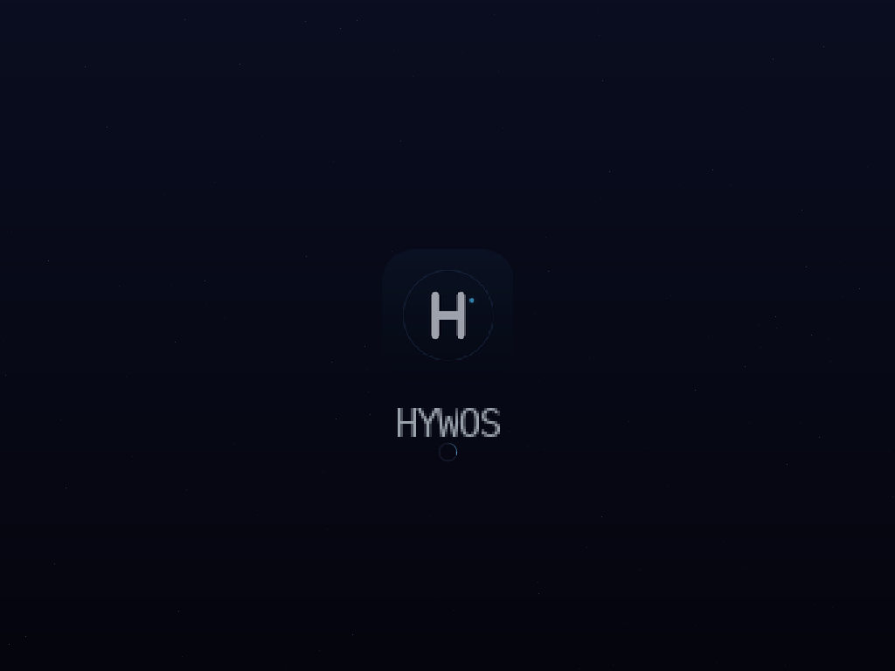
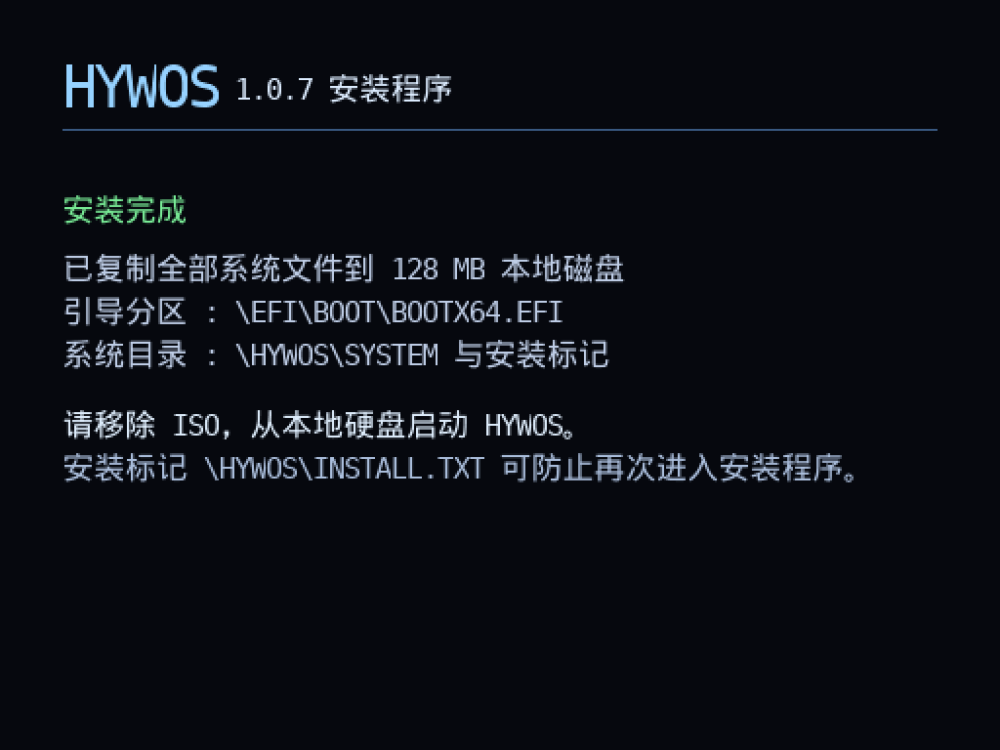
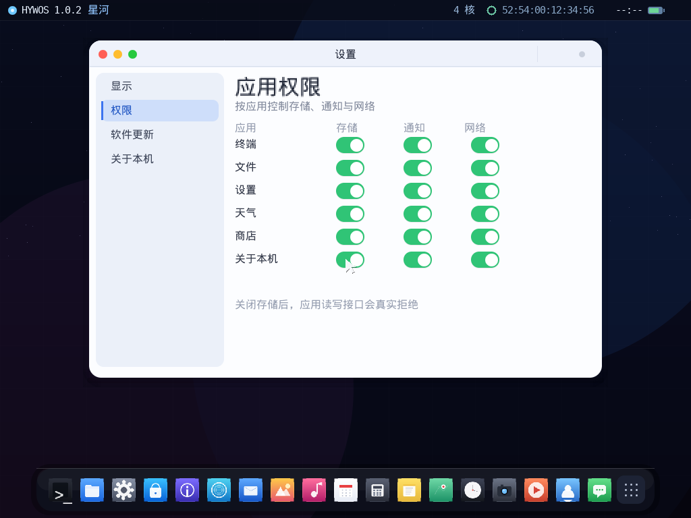

# HYWOS 1.0.7 «星河 · 安装与在线更新版»

<p align="center">
  
</p>

HYWOS 是一个用 Rust 编写的 64 位 UEFI 操作系统，不依赖任何第三方 crate，
以 `no_std` 方式直接运行在 UEFI 固件之上。1.0.2 增加了显卡、PS/2 键鼠与声卡的
寄存器级驱动，并保留 1.0.1 的完整中文界面。



## 目录

- [1.0.7 新变化](#107-新变化)
- [1.0.2 新变化](#102-新变化)
- [硬件驱动](#硬件驱动)
- [特性总览](#特性总览)
- [界面截图](#界面截图)
- [快捷键](#快捷键)
- [中文支持](#中文支持)
- [终端](#终端)
- [文件系统与应用存储](#文件系统与应用存储)
- [权限模型](#权限模型)
- [截屏](#截屏)
- [软件更新 .updpkg](#软件更新-updpkg)
- [构建](#构建)
- [在 QEMU 中运行](#在-qemu-中运行)
- [源码结构](#源码结构)
- [设计说明](#设计说明)
- [现实边界](#现实边界)
- [开源协议](#开源协议)

## 1.0.7 新变化

- **修复安装后仍进入安装程序**：安装介质判定改为只看当前启动卷，
  并在硬盘写入 `\HYWOS\INSTALL.TXT`。从硬盘启动时不会再被 ISO 残留设备误判。
- **安装流程重写**：ISO 启动先询问是否安装；确认后先把内核、系统资源、
  版本文件与安装标记**全部复制到本地磁盘**，最后才创建 FAT16 引导分区与 MBR 引导记录。
- **设置中新增在线更新**：通过 UEFI HTTP 协议读取 GitHub Releases 列表，与本地版本
  1.0.7 比较；发现新版本可下载 `.updpkg` 并应用，支持离线 `\updates\latest.json`
  回退与本地同版本包扫描。无指针设备时可用键盘 `←` / `→` 切页、`C` 检查、`D` 更新。
- **修复卷写入**：文件打开模式改为 `READ|WRITE`（FatPkg 只接受此组合），
  安装盘与用户卷现在可正常创建、替换文件，更新包能真实写入内核。
- 版本号升级到 1.0.7。

## 1.0.6 新变化

- **安装程序进度条**：命令行安装界面新增进度条与百分比，按阶段显示
  「写入 MBR 与 FAT16 引导分区」→「复制 BOOTX64.EFI 到 ESP」→「完成」，
  每阶段刷新并短暂停顿，便于观察安装过程。
- 版本号升级到 1.0.6。

## 1.0.5 新变化

- **修复安装器读取不到硬盘**：
  - 检测前对每个 Block I/O 设备执行 `Reset`，解决 `present=0` 导致漏检；
  - 容量门槛从 50MB 降到 **20MB**（`last_block >= 40000`），小容量硬盘也能安装；
  - 优先选择整盘（`LogicalPartition=0`）而不是分区；
  - 未找到磁盘时列出**检测到的块设备**（容量、块大小、只读、分区标志），便于排查；
  - 支持 IDE / SATA / virtio-blk / NVMe，兼容 **512 字节与 4096 字节（4Kn）** 逻辑块设备；
  - 安装前重复执行 `ConnectController` 并等待，设备延迟就绪也能被识别；
  - 诊断行额外显示「就绪」状态（MediaPresent）。
- **安装确认改为回车**：在确认界面直接按 **Enter** 开始安装，按 `N` 或 `Esc` 取消。
- 版本号升级到 1.0.5。

## 1.0.4 新变化

- **ISO 改为纯安装介质**：从 ISO 启动后进入**命令行安装程序**，先询问是否安装；
  确认后自动写入 MBR 分区表、创建 FAT16 引导分区（ESP）、
  把 `BOOTX64.EFI` 复制到 `\EFI\BOOT\`，重启即可从硬盘引导。
- **安装后从硬盘启动**：硬盘 ESP 不含安装介质标记，启动时直接进入
  星河动画与桌面，不再进入安装器。
- **修复启动画面文字过小**：HYWOS 标题放大到 32×64 像素/字符，
  粒子 O 与中文副标题同步放大（2×）。
- 版本号升级到 1.0.4。

## 安装 HYWOS

1. 为虚拟机/机器准备一块 **≥100MB 的可写磁盘**（安装器会写入 128MB 分区）。
2. 使用 `hywos.iso` 启动，进入命令行安装程序，界面会显示目标磁盘容量。
3. 直接按 **Enter** 确认（按 `N` 取消）。安装器按以下顺序执行：
   - 先复制全部系统文件到本地磁盘：`BOOTX64.EFI`、`\HYWOS\SYSTEM\WELCOME.TXT`、
     `\HYWOS\VERSION` 与安装标记 `\HYWOS\INSTALL.TXT`；
   - 目录与 FAT 表写入完成后，再创建 FAT16 引导分区（128MB，簇 4KB）
     并写入 MBR 引导记录（type 0x0E，起始 LBA 2048）；
4. 看到「安装完成」后关闭虚拟机，**移除 ISO**，从硬盘启动。
   硬盘上的安装标记会阻止再次进入安装程序。

如果提示「未找到可安装的硬盘」，界面会列出固件检测到的所有块设备，
请确认磁盘 ≥20MB、可写、块大小 512 字节。

安装器只会操作所选的可写磁盘；从 ISO 启动时不会进入桌面。

## 1.0.3 新变化

- **全新启动动画**：168 个粒子从四周螺旋汇聚成发光的 **O**，随后 O 收缩
  移动到标题位置，H、Y、W、S 依次淡入，最终构成 HYWOS 中的 O，
  并浮现「星河 · 中文界面 · 64 位」。
- **输入修复**：
  - 鼠标优先级改为 绝对指针（Absolute Pointer）→ SimplePointer → PS/2；
  - SimplePointer 单帧位移限幅 ±45，并丢弃 >150 的同步跳变；
  - PS/2 鼠标严格校验 ACK 与设备 ID，三字节包校验溢出位并过滤异常跳变；
  - PS/2 初始化重新独占键盘扫描，避免与固件驱动争抢数据。
- **现代键鼠**：新增 `src/input.rs`，接入 UEFI `SimpleTextInputEx` 与
  `AbsolutePointer`，并作为 PS/2 的回退/补充。
- **virtio-gpu**：新增 **modern virtio-pci** 支持（解析 PCI capability、
  协商 VIRTIO_F_VERSION_1、common cfg 配置队列、notify 区 MMIO 通知），
  与 legacy 共用同一套 2D 命令。
- 版本号升级到 1.0.3；测试环境切换到 **QEMU 11.1.3**（源码构建）。

## 1.0.2 新变化

- **显卡驱动**：新增 VBE/标准 VGA（Bochs VBE）、virtio-gpu（legacy 2D）、
  VMware SVGA II 三条驱动路径，探测顺序为 virtio-gpu → SVGA → VBE → UEFI GOP。
  驱动成功后分辨率提升到 1024×768 32bpp。
- **PS/2 键鼠**：直接初始化 8042 控制器，轮询键盘 Set-1 扫描码与鼠标三字节包，
  支持字母数字、Shift、方向键、F1–F12、Enter/Backspace/Esc。
- **声卡**：Intel AC'97（8086:2415）寄存器级驱动，48kHz 16-bit 立体声 DMA，
  启动时播放和弦提示音；无 AC'97 时回退 PC Speaker。
- **关于本机**展示实际显卡、输入与音频驱动名称。
- 版本号统一升级到 1.0.2。

## 硬件驱动

| 设备 | 驱动实现 | 验证状态 |
|---|---|---|
| 标准 VGA / Bochs VBE | PCI 1234:1111，VBE I/O 0x1CE/0x1CF，设置 1024×768×32 并使用 LFB | **QEMU `-vga std` 实测通过**（截图 1024×768） |
| virtio-gpu | legacy + modern virtio-pci，control virtqueue，2D 命令 | modern 协议已实现；QEMU 11 的 64 位 BAR 位于 0xC000000000，队列通知未生效，命令超时 |
| VMware SVGA II | PCI 15AD:0405，SVGA II 寄存器与 LFB，SYNC 刷新 | 代码完整；当前 QEMU 固件只暴露 index 寄存器，SetMode 失败时自动回退 GOP |
| UEFI GOP | 固件帧缓冲 | 实测通过（回退路径） |
| PS/2 键盘 | 8042，禁用/启用扫描，Set-1 扫描码表 | **实测通过**（QEMU sendkey F2 打开天气） |
| PS/2 鼠标 | 8042 AUX 通道，三字节包解析 | 已接入，与 UEFI SimplePointer 互补 |
| AC'97 声卡 | PCI 8086:2415，NAM/NABM，Buffer Descriptor List + DMA | **实测通过**（`-audiodev wav` 生成波形，峰值 14116/32767） |
| PC Speaker | PIT 通道 2 | 回退路径 |

驱动信息会显示在 `关于本机` 页面。若显卡驱动初始化失败，系统自动回退
UEFI GOP；若 PS/2 不可用，回退固件输入；若 AC'97 不存在，使用 PC Speaker。

## 特性总览

| 能力 | 实现 |
|---|---|
| 启动 | UEFI x86_64，PE32+ `BOOTX64.EFI`，El Torito ISO |
| 语言 | Rust 1.100，`no_std`，零外部依赖，手写 EFI/PCI/驱动 |
| 中文 | 6786 字 GB2312 点阵，UTF-8 混排渲染，中文界面 |
| 显卡 | VBE、virtio-gpu、VMware SVGA II、UEFI GOP 回退 |
| 输入 | PS/2 8042 键鼠 + UEFI SimplePointer 回退 |
| 音频 | Intel AC'97 DMA 播放 + PC Speaker 回退 |
| 图形 | 双缓冲合成器，圆角/渐变/抗锯齿/阴影 |
| 开机动画 | 星河主题：星点汇聚、双层光环、徽标淡入、中文副标 |
| 图标 | 256×256 画布 4× 超采样后降采样到 64px 缓存 |
| 桌面 | 中文状态栏、19 槽浮动 Dock、窗口栈、鼠标光标 |
| Launchpad | 6 列网格，渐暗与错峰缩放，搜索框，中文名称 |
| 应用 | 终端、文件、设置、天气、应用商店、关于本机 |
| 多核 | ACPI MADT + CPUID 拓扑，QEMU 中实测 `4 核` |
| 存储 | UEFI SimpleFileSystem；无可写卷时内存文件系统回退 |
| 更新 | GitHub Releases 在线检查 + CONLYUPD 包，CRC32 校验，内核文件替换 |
| 截屏 | F12 / Print Screen，24 位 BMP，编号递增 |

## 界面截图

| 启动动画（粒子 O，已放大） | 安装程序（命令行） |
|---|---|---|
|  |  |

| 安装进度 | 安装完成 |
|---|---|
|  |  |

| 桌面（从硬盘启动） |
|---|
|  |

| Launchpad | 天气 |
|---|---|
|  |  |

| 设置 · 权限 | 设置 · 软件更新 |
|---|---|
|  |  |

| 应用商店 |
|---|
|  |

| 关于本机（驱动信息） | 终端 |
|---|---|
|  |  |

| 文件 |
|---|
|  |

截图由 QEMU 运行 `hywos.iso` 安装后、从硬盘启动，通过 VNC 抓取 framebuffer 原始画面，
未做修图。全部截图由 **QEMU 11.1.3** 运行 HYWOS 1.0.7 生成：
ISO 启动询问 → Enter 安装 → 复制系统文件 → 创建 FAT16 引导分区 →
移除 ISO 从硬盘启动 → 使用 F1–F8 切换各界面。

## 快捷键

| 按键 | 作用 |
|---|---|
| `F1` | 启动台 |
| `F2` | 天气 |
| `F3` | 设置（权限页） |
| `F4` | 应用商店 |
| `F5` | 关于本机 |
| `F6` / `F8` | 文件 |
| `F7` | 终端 |
| `F12` | 截屏 |
| `Esc` | 关闭启动台或当前窗口 |

设置窗口内：`←` / `→` 切换页面；在「软件更新」页按 `C` 检查更新、`D` 下载并安装。
安装程序界面：`Enter` 开始安装，`N` 或 `Esc` 取消且不修改磁盘。

启动台打开时直接键入即可过滤，匹配中文名称与英文 ID；`Enter` 启动第一项。

## 中文支持

`tools/gen_cjk.py` 生成 16×16 4bpp 点阵，覆盖 GB2312 一级与二级共 6786 字。
`gfx::text` 自动 UTF-8 解码，ASCII 8×16 与中文 16×16 混排，宽度按实际字符计算。
键盘当前处理 ASCII 输入，中文输入法不在范围内。

## 终端

`user@hywos:~$` 提供：

```
help  clear  ls  cd  pwd  cat  echo  mkdir  rm  cp  mv
uname ps  free date df  mount whoami uptime weather
screenshot  appstore  exit
```

## 文件系统与应用存储

```
\home\user\
├── .apps\<appid>.kv 与 _permissions
├── Documents\
├── Pictures\
└── Screenshots\shot-NNNN.bmp
```

`appstore_set/get/del` 每个应用独立 KV，值上限 120 字符。无可写卷时打印
`no writable volume, RAM fallback` 并启用内存文件系统。

## 权限模型

`设置 → 权限` 控制存储、通知、网络；关闭存储后存储 API 真实拒绝，
记录写入 `.apps/_permissions`。

## 截屏

F12 / Print Screen 抓取 24 位 BMP，编号递增，状态栏提示；
`设置 → 显示 → 立即截屏` 同样可用。

## 软件更新 .updpkg

`CONLYUPD` 头 + CRC32，Files 双击打开 `设置 → 软件更新`。更新包可携带完整内核，
应用时替换 `\EFI\BOOT\BOOTX64.EFI` 并更新 `\HYWOS\VERSION`；不支持文件替换的旧设备
回退到目标 LBA（默认 64），不触碰用户数据卷。

`设置 → 软件更新 → 检查更新` 会请求 GitHub Releases 列表
（`https://api.github.com/repos/lmxdg/HYWOS/releases`），解析 `tag_name`
并与本地 1.0.7 比较。发现新版本后可从 `browser_download_url` 下载 `.updpkg`，
保存到 `\updates\hywos-<版本>.updpkg` 后应用。固件没有 HTTP/TLS 服务或网络
未配置时，会读取 `\updates\latest.json` 并扫描 `\updates` 中的更新包作为离线回退。

## 构建

```bash
rustup target add x86_64-unknown-uefi
cargo build --release --target x86_64-unknown-uefi
sh tools/mkiso.sh
```

生成字体与 LOGO 数据：

```bash
python3 tools/gen_cjk.py
python3 tools/gen_logo_data.py
```

产物：`build/hywos.iso`、`build/efiboot.img`、`build/usb.img`、
`build/kdisk.img`、`build/hywos-1.0.7.updpkg`。

## 在 QEMU 中运行

标准 VGA + AC'97 + PS/2（驱动实测配置）：

```bash
qemu-system-x86_64 -M q35 -m 512 -smp 4 -usb \
  -bios /usr/share/edk2/ovmf/OVMF.fd \
  -vga std -device AC97 \
  -drive file=build/install.img,format=raw,if=none,id=target \
  -device virtio-blk-pci,drive=target \
  -drive file=build/hywos.iso,media=cdrom,readonly=on \
  -drive file=build/usb.img,if=none,id=usbdisk,format=raw \
  -device usb-storage,drive=usbdisk \
  -drive file=build/kdisk.img,if=none,id=kdisk,format=raw \
  -device virtio-blk-pci,drive=kdisk \
  -netdev user,id=n0 -device virtio-net-pci,netdev=n0
```

virtio-gpu / VMware SVGA：

```bash
# 需要 QEMU 构建包含 virtio-gpu-device
qemu-system-x86_64 ... -device virtio-vga
# SVGA II
qemu-system-x86_64 ... -device vmware-svga
```

验证声卡输出可加 `-audiodev wav,id=snd,path=build/audio.wav -device AC97,audiodev=snd`，
启动后会在 WAV 中看到启动和弦波形。

## 源码结构

```
src/
├── main.rs      EFI 入口、启动序列、panic 处理、mem* 实现
├── efi.rs       手写 EFI 协议绑定
├── port.rs      I/O 端口与 PCI 配置空间（CF8/CFC、BAR、Bus Master）
├── video.rs     VBE / VMware SVGA II / virtio-gpu 2D 与刷新
├── ps2.rs       8042 键盘与鼠标
├── audio.rs     AC'97 DMA 播放与 PC Speaker
├── gfx.rs       合成器、UTF-8 混排、圆角/渐变/抗锯齿
├── font.rs      ASCII 4bpp 位图字体
├── cjk.rs       GB2312 6786 字 16×16 点阵
├── logo.rs      关于页 128×128 RGBA LOGO
├── icon.rs      程序化图标 + 4× 超采样 + 64px 缓存
├── anim.rs      星河开机动画
├── hw.rs        ACPI MADT、CPUID、SNP、RTC、SimplePointer
├── fs.rs        文件系统、RAM 回退、KV、权限、BMP、updpkg、Block I/O
├── ui.rs        桌面、状态栏、Dock、启动台、窗口栈、双缓冲
└── apps/mod.rs  终端 / 文件 / 设置 / 天气 / 商店 / 关于
```

## 设计说明

**驱动选择**：`video::probe` 依次尝试 virtio-gpu、VMware SVGA II、VBE，
任何一步成功即接管 framebuffer 与刷新；全部失败才使用 UEFI GOP。
合成器仍渲染到后台缓冲，`present` 后由驱动执行 transfer/flush 或 SYNC。

**PS/2**：初始化时禁用并重新启用扫描，读取时用 8042 状态端口 bit5 区分
键盘与 AUX 鼠标数据，避免共享 0x60 端口的歧义。

**AC'97**：冷复位后设置主音量与 PCM 音量、48kHz 采样率，构造 Buffer
Descriptor List，写 BDBR/LVI 并置 RPBM 启动 DMA，播放三音和弦。

**中文字体**：码点升序 + 二分查找，缺字回退空心方框。

**图标**：256×256 画布绘制后 4×4 盒式降采样到 64×64，Dock 由大图缩小。

## 现实边界

真实实现：UEFI 启动、VBE 显卡、PS/2 键鼠、AC'97 DMA、GOP 回退、
中文字体与混排、图标超采样、动画、ACPI/CPUID、SNP、KV、权限拒绝、
BMP 截屏、CONLYUPD、Block I/O、终端文件操作。

受限：

- **virtio-gpu** modern 协议已实现，但 QEMU 11 + OVMF 将 64 位 BAR 分配在
  0xC000000000，UEFI 应用侧队列通知未生效，仍需 PciIo.Map 映射；
- **VMware SVGA II** 在当前 QEMU 固件下只能访问 index 寄存器，
  SetMode 失败后回退 GOP；
- 无自有 TCP/IP 协议栈，仅展示 SNP 的真实 MAC/链路状态；
- 多核为拓扑真实 + 单核协作式调度，无 AP trampoline；
- 文件系统为 FAT32；无中文输入法；
- 固件无可写卷时使用内存文件系统，重启后数据丢失。

## 开源协议

MIT License，见 [LICENSE](LICENSE)。