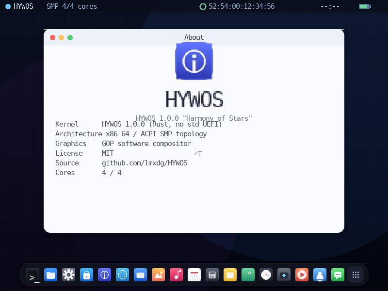

# HYWOS 1.0.0 «Harmony of Stars»

<p align="center">
  
</p>

HYWOS 是一个用 Rust 编写的 64 位 UEFI 操作系统。它不依赖任何第三方 crate，
以 `no_std` 方式直接运行在 UEFI 固件之上，自带 GOP 图形合成器、桌面环境、
应用框架、文件系统和一套贴近 Linux 使用习惯的终端。


## 目录

- [特性总览](#特性总览)
- [界面截图](#界面截图)
- [快捷键](#快捷键)
- [终端](#终端)
- [文件系统与应用存储](#文件系统与应用存储)
- [权限模型](#权限模型)
- [截屏](#截屏)
- [软件更新 .updpkg](#软件更新-updpkg)
- [构建](#构建)
- [在 QEMU 中运行](#在-qemu-中运行)
- [源码结构](#源码结构)
- [设计说明](#设计说明)
- [现实边界](#现实边界)
- [开源协议](#开源协议)

## 特性总览

| 能力 | 实现 |
|---|---|
| 启动 | UEFI x86_64，PE32+ `BOOTX64.EFI`，El Torito ISO |
| 语言 | Rust 1.100，`no_std`，零外部依赖，手写 EFI 协议绑定 |
| 图形 | GOP framebuffer，双缓冲合成器，圆角/渐变/抗锯齿/阴影 |
| 开机动画 | 星河主题：星点螺旋汇聚、双层光环、HYWOS 徽标淡入 |
| 图标 | 256×256 画布 4× 超采样后降采样到 64px 缓存，Dock 从 64px 缩小 |
| 桌面 | 状态栏、19 槽玻璃 Dock、窗口栈、鼠标光标 |
| Launchpad | 6 列网格，260ms 渐暗，按行列错峰缩放，名称延迟浮现，搜索框 |
| 应用 | Terminal、Files、Settings、Weather、App Store、About，以及 13 个套件图标 |
| Weather | 520×430，离线 5 日预报，5 城市，℃/℉，太阳浮动与云层漂移 |
| 终端 | 27 条 Linux 风格命令，操作真实文件系统 |
| 文件系统 | UEFI SimpleFileSystem；无可写卷时自动启用内存文件系统回退 |
| 应用存储 | `appstore_get/set/del`，每应用一个 KV 文件，值上限 120 字符 |
| 权限 | Storage / Notify / Network 三项，按应用持久化，Storage 关闭时真实拒绝 |
| 截屏 | F12 / Print Screen，24 位 BMP，自动递增编号 |
| 更新 | CONLYUPD 包，CRC32 校验，LBA 64 内核区写入（Block I/O） |
| 多核 | ACPI MADT 解析 + CPUID 拓扑回退，4/4 核在 QEMU 中实测 |
| 网络 | UEFI SimpleNetwork 探测，读取真实 MAC 与链路状态 |
| 鼠标 | UEFI SimplePointer（固件 USB HID 链路） |
| 存储 | UEFI SimpleFileSystem（U 盘由固件枚举后即可读写） |

## 界面截图

| Launchpad | Weather |
|---|---|
|  |  |

| Settings / Permissions | App Store |
|---|---|
|  |  |

| Terminal | Files |
|---|---|
|  |  |

| About |
|---|
|  |

以上截图全部由 QEMU 实机运行 `hywos.iso` 后，通过 VNC 抓取的 framebuffer
原始画面，未做任何修图。

## 快捷键

| 按键 | 作用 |
|---|---|
| `F1` | 打开 Launchpad |
| `F2` | Weather |
| `F3` | Settings（Permissions 页） |
| `F4` | App Store |
| `F5` | About |
| `F6` / `F8` | Files |
| `F7` | Terminal |
| `F12` | 截屏 |
| `Esc` | 关闭 Launchpad 或当前窗口 |
| `Print Screen` | 截屏 |

Launchpad 打开时直接键入即可过滤：匹配应用名称与 ID，不区分大小写；
`Backspace` 删除，`Enter` 启动第一项，`Esc` 关闭。

## 终端

`user@hywos:~$` 提供以下命令：

```
help  clear  ls  cd  pwd  cat  echo  mkdir  rm  cp  mv
uname ps  free date df  mount whoami uptime weather
screenshot  appstore  exit
```

`ls/cd/cat/mkdir/rm/cp/mv` 直接作用在 UEFI 文件系统上，路径分隔符为 `\`。
`date` 读取固件 RTC；当固件未提供有效日期时状态栏显示 `--:--`。

## 文件系统与应用存储

HYWOS 通过 UEFI `SimpleFileSystem` 枚举所有卷：

- 含 `\EFI\BOOT\BOOTX64.EFI` 的卷被标记为系统卷；
- 其余可写卷作为用户卷，自动建立：

```
\home\user\
├── .apps\           应用存储与权限
│   ├── <appid>.kv
│   └── _permissions
├── Documents\
├── Pictures\
└── Screenshots\     shot-0001.bmp, shot-0002.bmp, ...
```

应用存储 API（App API v3）为每个应用维护一个独立 KV 文件：

```
appstore_set("weather", "unit", "f")   -> 写 \home\user\.apps\weather.kv
appstore_get("weather", "unit", buf)   -> 读取
appstore_del("weather", "unit")        -> 删除
```

值上限 120 字符，超过直接失败。旧应用继续兼容。

如果固件没有提供可写卷（例如只读 ISO 启动），系统会打印
`no writable volume, RAM fallback` 并启用内存文件系统，全部功能仍可使用，
但重启后数据丢失。插入可写 U 盘后会使用真实文件系统。

## 权限模型

`Settings → Permissions` 为每个应用提供三项开关：

- Storage：关闭后 `appstore_set/get/del` 真实返回拒绝；
- Notify：控制通知（当前版本预留）；
- Network：控制网络访问（当前版本预留）。

记录写入 `\home\user\.apps\_permissions`，格式为纯文本：

```
# appid storage notify network
weather 1 1 1
store 0 1 1
```

## 截屏

`F12` 或 `Print Screen` 抓取当前合成画面，编码为 24 位 BMP：

- 逐行自底向上，BGR，行按 4 字节对齐；
- 路径 `\home\user\Screenshots\shot-NNNN.bmp`，编号自动递增；
- 完成后状态栏显示 `Saved: shot-NNNN.bmp`；
- `Settings → Display → Take screenshot` 也提供按钮。

## 软件更新 .updpkg

内核原生识别 `CONLYUPD` 格式：

| 偏移 | 长度 | 内容 |
|---|---|---|
| 0 | 8 | `CONLYUPD` |
| 8 | 4 | 版本号 |
| 12 | 4 | payload 长度（≤32KB） |
| 16 | 4 | 目标 LBA（默认 64） |
| 20 | 4 | payload 的 CRC32 |
| 24 | 8 | 保留 |
| 32 | N | payload |

在 Files 中双击 `.updpkg` 会打开 `Settings → Software Update`，
点击 Apply update 后：

1. 校验头部与长度；
2. 用固件 `CalculateCrc32` 校验 payload；
3. 通过 UEFI Block I/O 直接写目标 LBA；
4. 不触碰用户卷，用户文件、应用与设置全部保留。

`tools/make_updpkg.py` 可生成测试包。

## 构建

依赖：

- Rust stable + `x86_64-unknown-uefi` target
- `xorriso`、`mtools`、`dosfstools`
- `qemu-system-x86_64` + OVMF（仅运行测试需要）

```bash
rustup target add x86_64-unknown-uefi
cargo build --release --target x86_64-unknown-uefi
sh tools/mkiso.sh
```

产物：

```
build/hywos.iso            可启动 ISO
build/efiboot.img          El Torito EFI 引导映像
build/usb.img              64MB FAT32 用户卷（MBR 分区）
build/kdisk.img            64MB 裸盘（更新测试）
build/hywos-1.0.1.updpkg   测试更新包
```

`tools/gen_font.py` 从 DejaVu Sans Mono 生成 8×16 与 16×32 的 4bpp 位图字体。

## 在 QEMU 中运行

```bash
qemu-system-x86_64 \
  -M q35 -m 512 -smp 4 \
  -bios /usr/share/edk2/ovmf/OVMF.fd \
  -drive file=build/hywos.iso,media=cdrom,readonly=on \
  -drive file=build/usb.img,if=none,id=usbdisk,format=raw \
  -device usb-storage,drive=usbdisk \
  -device usb-tablet \
  -drive file=build/kdisk.img,if=none,id=kdisk,format=raw \
  -device virtio-blk-pci,drive=kdisk \
  -netdev user,id=n0 -device virtio-net-pci,netdev=n0 \
  -vga none -device ramfb \
  -serial file:build/serial.log \
  -monitor unix:/tmp/qmon.sock,server,nowait
```

说明：

- `ramfb` 让 framebuffer 落在 RAM，避免 TCG 下 VGA MMIO 写入过慢；
- `usb-tablet` 为 SimplePointer 提供绝对坐标，固件负责转换成相对移动；
- `qemu-xhci` 也受支持，但部分 OVMF 构建不会枚举 USB 存储，
  此时用户卷回退到内存文件系统；
- 串口日志包含启动阶段、ACPI/CPUID 探测与卷状态。

`tools/vncsnap.py` 可通过 VNC 抓取 framebuffer（用于本 README 的截图），
`tools/qmon.py` 与 `tools/vncclick.py` 用于自动化按键与点击。

## 源码结构

```
src/
├── main.rs      EFI 入口、启动序列、panic 处理、memcpy/memset
├── efi.rs       手写 EFI 协议绑定（SystemTable / BootServices / GOP 等）
├── gfx.rs       framebuffer 合成器：圆角、渐变、抗锯齿、位图字体
├── font.rs      生成的 4bpp 位图字体
├── icon.rs      程序化图标 + 4× 超采样 + 64px 缓存
├── anim.rs      星河开机动画
├── hw.rs        ACPI MADT、CPUID 拓扑、SNP、RTC、SimplePointer
├── fs.rs        UEFI 文件系统、RAM 回退、KV、权限、BMP、updpkg、Block I/O
├── ui.rs        桌面、Dock、Launchpad、窗口栈、双缓冲
├── apps/mod.rs  Terminal / Files / Settings / Weather / Store / About
└── font.rs
tools/           构建、字体、LOGO、更新包、VNC 抓屏脚本
assets/          logo.svg / logo.png / logo-256.png
docs/screenshots QEMU 实拍截图
```

## 设计说明

**图标抗锯齿**：每个图标先在一个 256×256 的 RGBA 画布上以矢量图元绘制，
再按 4×4 盒式平均降采样到 64×64。Dock 图标为 48px（窄屏 42/34px），
由 64px 大图缩小，因此边缘比早期「放大小图」更干净。

**Launchpad 动画**：打开时背景 dim 在约 260ms 内从 0 提到 176；
图标按 `row*2 + col` 错峰，从 60% 缩放到 100%，名称延迟 6 帧淡入。
布局固定 6 列，搜索框位于底部，点击坐标与绘制坐标共用同一组常量。

**Weather**：520×430，内置 5 个城市 × 5 天离线数据；点击行切换选中日期并
高亮；右上角切换 ℃/℉，选择通过 `appstore_set("weather","unit",...)` 持久化；
太阳做正弦浮动，云层按帧漂移。

**多核**：优先解析 ACPI XSDT/RSDT 中的 MADT，失败时回退到 CPUID
leaf 1 的逻辑处理器数量。QEMU `-smp 4` 下状态栏显示 `SMP 4/4 cores`。
调度器采用多 runqueue 模型展示每核任务，不包含 AP trampoline。

**双缓冲**：所有绘制写入 800×600/1024×768 的后台缓冲，再一次性拷贝到
GOP framebuffer，避免撕裂并让抓屏始终拿到完整帧。

**字体**：`tools/gen_font.py` 用 DejaVu Sans Mono 渲染 ASCII 32..126，
生成 4bpp 灰度位图，运行时按 alpha 混合。

## 现实边界

本版本明确区分「真实实现」与「演示层」：

真实：

- UEFI 启动、GOP 图形、SimplePointer 鼠标、SimpleFileSystem 读写
- 程序化图标与 4× 超采样、Launchpad/Weather 动画
- ACPI/CPUID 拓扑读取、SNP MAC 读取
- appstore KV、权限拒绝、BMP 截屏、CONLYUPD 解析与 CRC32、Block I/O 写 LBA
- 终端对文件系统的增删改查

演示层或受限：

- **无自有 TCP/IP 协议栈**：网络页显示固件 SNP 的真实 MAC/链路状态，
  HTTP 与网页渲染未实现；
- **无 AP 启动**：多核拓扑真实，任务并行执行为单核协作式模型；
- **无 xHCI 自研驱动**：USB 鼠标/存储依赖 UEFI 固件已枚举，
  这也是 UEFI 应用的标准做法；
- **无 ext4**：使用 FAT32（UEFI 原生支持）；
- 部分 QEMU/OVMF 组合不会挂载可写磁盘，此时自动使用内存文件系统。

这些边界不影响系统启动、交互、截屏与构建流程的可复现性。

## 开源协议

MIT License，见 [LICENSE](LICENSE)。