# HYWOS

<p align="center">
  
</p>

<p align="center">
  <b>当前版本 1.1.3 «星河»</b> · MIT · x86_64 UEFI
</p>

HYWOS 是一个用 Rust 从零编写的 64 位 UEFI 操作系统。它不链接任何第三方 crate，
以 `no_std` 方式直接运行在固件之上，自带显卡、输入、音频驱动、桌面环境、
应用套件与安全中心，可制作启动 U 盘或 ISO 安装到本地磁盘。

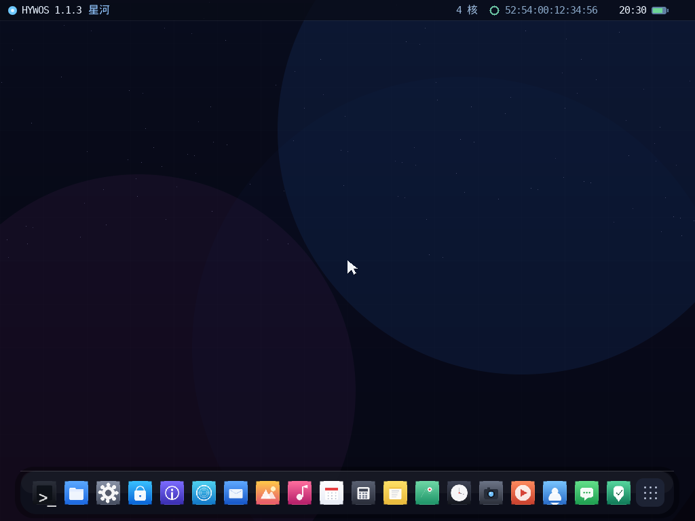

## 目录

- [设计目标](#设计目标)
- [应用套件](#应用套件)
- [安全中心](#安全中心)
- [显示](#显示)
- [输入](#输入)
- [音频](#音频)
- [硬件与驱动](#硬件与驱动)
- [宏内核（Monolithic）](#宏内核monolithic)
- [Ring3 与双页表](#ring3-与双页表)
- [系统架构](#系统架构)
- [文件系统与数据](#文件系统与数据)
- [构建](#构建)
- [在-QEMU-中运行](#在-qemu-中运行)
- [应用开发](#应用开发)
- [快捷键](#快捷键)
- [界面截图](#界面截图)
- [版本历史](#版本历史)
- [现实边界](#现实边界)
- [开源协议](#开源协议)

## 设计目标

- **零依赖**：不引入任何 crate，直接手写 UEFI 协议绑定、图形合成、文件系统与驱动。
- **宏内核**：驱动、文件系统、网络、音频、图形与桌面全部运行在 ring0 单地址空间，
  统一由内核子系统层管理；用户程序通过 `int 0x80` 进入内核系统调用。
- **真实可用**：桌面上的每个应用都有实际功能与持久化数据，不使用占位页面。
- **本地优先**：数据写入用户卷；网络能力由固件 HTTP 提供，离线时功能完整。
- **可安装、可更新**：ISO 安装到本地磁盘，`.updpkg` 更新内核并保留用户数据。

## 应用套件

| 应用 | 能力 | 数据位置 |
|---|---|---|
| 终端 | 27 条命令：文件、系统、网络、截屏、更新 | 当前目录 |
| 文件 | 浏览用户卷，双击打开文本/更新包 | 用户卷 |
| 设置 | 显示、权限、软件更新、关于本机 | `\home\user\.apps` |
| 应用商店 | 安装状态持久化 | `\home\user\.apps` |
| 关于本机 | 显卡/输入/音频/CPU/内存真实信息 | 只读 |
| 浏览器 | 本地页面、UEFI HTTP 打开网址 | `\HYWOS\SYSTEM` |
| 邮件 | 本地收件箱/发件箱，撰写保存 | `\home\user\Mail` |
| 照片 | 解码浏览 24 位 BMP | `\home\user\Pictures` |
| 音乐 | 播放 PCM WAV，内置音阶 | `\home\user\Music` |
| 日历 | RTC 月历、切月、当天高亮 | RTC |
| 计算器 | 四则、括号、小数、键盘与按钮 | 内存 |
| 备忘录 | 新建/编辑/保存，Ctrl+S | `\home\user\Notes` |
| 地图 | 经纬网、大陆轮廓、城市、平移缩放 | 内置 |
| 时钟 | 模拟钟面、数字时间、秒表 | RTC |
| 相机 | 实时取景，保存全屏 BMP | `\home\user\Screenshots` |
| 视频 | BMP 序列循环播放 | `\home\user\Videos` |
| 通讯录 | 联系人浏览与新增 | `\home\user\Contacts` |
| 信息 | 本地消息记录与发送 | `\home\user\Messages` |
| 安全中心 | 实时监控、快速/全盘查杀、病毒库 | `\HYWOS\SECURITY` |
| 天气 | 5 城市离线 5 日预报（启动台） | 内置 |

Dock 为 **19 个应用 + 启动台**，启动台展示全部 20 个应用。
应用首次打开时会自动创建缺失目录与示例记录。

## 安全中心

- **实时监控**：逻辑核心数、内存总量/可用量、运行时间、实时防护状态。
  内存可用率每 24 帧采样并绘制趋势线，数据来自 `GetMemoryMap` 真实结果。
- **快速查杀**：检查内核、版本文件、安装标记、系统资源与权限文件。
- **全盘查杀**：递归系统卷与用户卷（深度 4、最多 400 个文件），
  逐个计算 FNV-1a 签名并与病毒库比对，显示进度、当前文件与日志。
- **病毒库**：`\HYWOS\SECURITY\VIRUS.DB`，每行 `8位十六进制签名|名称`。
  可从用户卷或系统卷加载；未提供病毒库时签名数量为 0，扫描结果为
  “未发现匹配威胁”。

## 显示

- 显卡探测顺序：virtio-gpu（legacy 2D）→ VMware SVGA II → VBE → UEFI GOP。
- SVGA 读取 `MAX_WIDTH/MAX_HEIGHT` 选择安全模式，并校验 32bpp。
- 软件合成器支持到 **1920×1080**；1024×768 与 1280×800 均完整显示状态栏与 Dock。
- 启动动画：LOGO 淡入 + `HYWOS` 文字，无副标题，约 2.4 秒。

## 输入

| 优先级 | 键盘 | 指针 |
|---|---|---|
| 1 | UEFI `ConIn`（先 CheckEvent） | `AbsolutePointer` |
| 2 | UEFI `SimpleTextInputEx` | `SimplePointer` |
| 3 | PS/2 8042（自动接管） | PS/2 8042 鼠标 |
| 4 | USB HID（EFI_USB_IO） | USB HID 绝对/相对鼠标 |

- PS/2 驱动支持 Shift/Caps、方向键、F1–F12、左右键；鼠标位移钳制不丢包。
- USB HID 解析接口、端点与报告描述符，支持启动协议键盘、相对与绝对鼠标；
  仅在固件未提供对应驱动时接管。

## 网络

- 自研 PCI 网卡驱动：Intel 82540EM/82574L（e1000）、Realtek RTL8139、
  virtio-net（legacy）。驱动完成 PCI 枚举、总线主控、DMA 收发环、MAC 与链路状态。
- 最小协议栈：ARP 解析与 IPv4/ICMP Echo，终端 `ping <IP>` 可做连通性测试。
- 默认静态配置：`10.0.2.15/24`，网关 `10.0.2.2`；可在终端 `net` 查看
  驱动型号、MAC、链路、IP、收发计数。
- 浏览器与在线更新仍使用固件 `EFI_HTTP_PROTOCOL`（含 TLS），内核 TCP/IP 栈不在本版本范围。
- QEMU 实测：Intel e1000/82574L 与 virtio-net（legacy）完成 ARP/ICMP 与 ping；
  RTL8139 驱动已实现，当前测试环境未完成收包验证。

## 音频

- Intel AC'97（8086:2415）DMA 播放，48 kHz 16 位立体声。
- 启动提示音、音乐应用 WAV 播放与音阶演示。

## 硬件与驱动

| 类别 | 驱动 |
|---|---|
| 显卡 | virtio-gpu 2D、VMware SVGA II、Bochs VBE、UEFI GOP 回退 |
| 输入 | PS/2 8042、UEFI Ex/绝对指针/SimplePointer、USB HID |
| 音频 | Intel AC'97；无设备时 PC Speaker |
| 存储 | UEFI Block I/O + SimpleFileSystem，4Kn 支持 |
| 网络 | Intel e1000/82574L、Realtek RTL8139、virtio-net（legacy）；UEFI SNP 回退 |
| 固件 | ACPI MADT、CPUID、RTC、SMBIOS 字符串 |

## 宏内核（Monolithic）

HYWOS 采用宏内核架构：所有内核服务运行在同一 ring0 地址空间，模块之间通过
内核 API 直接调用，避免微内核的 IPC 开销。

| # | 子系统 | 职责 | 实现 |
|---|---|---|---|
| 1 | Video | 显卡探测、framebuffer、模式设置 | `video.rs` / `gfx.rs` |
| 2 | Input | PS/2、USB HID、UEFI 指针、键盘 | `input.rs` / `ps2.rs` / `usbhid.rs` |
| 3 | Storage | 卷、FAT16/FAT32、文件与目录 | `fs.rs` / `diskfmt.rs` |
| 4 | Network | e1000/82574L、RTL8139、virtio-net、ARP/ICMP | `net.rs` |
| 5 | Audio | AC'97 DMA 与 PC Speaker | `audio.rs` |
| 6 | UI | 合成器、窗口、Dock、启动台、应用 | `ui.rs` / `apps/` |
| 7 | Ring3 | GDT/TSS/IDT、双页表、用户程序 | `ring3.rs` |
| 8 | Updates | `.updpkg`、GitHub Releases、离线回退 | `updater.rs` / `http.rs` |

- `src/kernel.rs` 维护子系统状态、提供统一内核 API（CPU/内存/运行时间/网卡/
  音视频/窗口等）与系统调用入口 `kernel::syscall`。
- 终端 `kernel` 命令列出 8 个子系统的状态与说明；关于本机与安全中心显示
  “宏内核 · N/8 子系统就绪”。
- 宏内核不排斥用户态：Ring3 程序仍可通过 `int 0x80` 请求内核服务。

## Ring3 与双页表

- **用户态（CPL3）**：自定义 GDT 在固件 GDT 基础上追加用户代码/数据段、内核数据段与
  64 位 TSS；TSS.RSP0 指向独立内核栈，`int 0x80` 从用户态进入内核时自动切换栈。
- **双页表**：
  - 内核页表：identity 映射 0–4 GB（2 MB 大页，U/S=0），供内核/UEFI 使用。
  - 用户页表：复制内核映射，并在 PML4[128] 建立用户代码与用户栈
    （`0x0000_4000_0000_0000` / `+0x1000`，各级 U/S=1）。
  - 进入用户程序时切换 CR3；退出/异常时恢复内核 CR3。
- **系统调用**：`int 0x80`，调用号 1=输出、2=退出、3=运行时间；
  DPL=3 的中断门，参数与结果通过寄存器传递。
- **异常隔离**：IDT 覆盖 #PF/#GP/#UD/#DF；用户态访问内核地址（如 `0x1000`）
  触发 #PF，处理程序记录 CR2 后安全返回内核，系统继续运行。
- **验证入口**：终端 `ring3` 运行正常 syscall/exit 程序，`ring3f` 运行页错误隔离测试；
  关于本机显示“Ring0 内核 · Ring3 用户态 · 双页表”。

## 系统架构

启动流程：

1. 固件加载 `\EFI\BOOT\BOOTX64.EFI`。
2. 探测显卡并建立合成器；挂载卷，判定启动卷与安装介质。
3. 若从 ISO 启动：询问安装 → 复制系统文件 → 创建 FAT16 引导分区。
4. 否则：LOGO 淡入动画 → 预生成图标 → 探测 ACPI/网络/输入/音频 → 桌面。

核心模块：

| 文件 | 职责 |
|---|---|
| `src/main.rs` | EFI 入口、启动流程、内存函数 |
| `src/efi.rs` | UEFI 协议绑定、ConIn、CRC32、内存映射 |
| `src/kernel.rs` | 宏内核子系统表、统一内核 API、系统调用入口 |
| `src/video.rs` | virtio-gpu / SVGA / VBE / GOP |
| `src/gfx.rs` | 32bpp 合成、UTF-8 混排、圆角/渐变/位图 |
| `src/cjk.rs` | GB2312 点阵字库（6786 字） |
| `src/fs.rs` / `src/diskfmt.rs` | 文件系统、FAT16 安装、BMP 截屏、更新包 |
| `src/ui.rs` | 窗口栈、Dock、启动台、合成与截屏 |
| `src/apps/mod.rs` | 终端、文件、设置、商店、天气、关于 |
| `src/apps/suite.rs` | 应用套件与安全中心 |
| `src/ps2.rs` / `src/usbhid.rs` / `src/input.rs` | 输入驱动 |
| `src/audio.rs` | AC'97 |
| `src/anim.rs` | LOGO 淡入动画 |
| `src/http.rs` / `src/updater.rs` | 固件 HTTP、在线更新 |

## 文件系统与数据

```
用户卷\
├── home\user\
│   ├── .apps\<appid>.kv 与 _permissions
│   ├── Documents\  Pictures\  Screenshots\
│   ├── Notes\  Music\  Videos\
│   ├── Contacts\  Messages\  Mail\
│   └── updates\
└── updates\latest.json
系统卷\
├── EFI\BOOT\BOOTX64.EFI
└── HYWOS\
    ├── VERSION  INSTALL.TXT
    ├── SYSTEM\WELCOME.TXT
    └── SECURITY\VIRUS.DB（可选）
```

- 权限：设置中按应用控制存储、通知、网络；关闭存储后应用读写接口真实拒绝。
- 更新：`.updpkg`（CONLYUPD + CRC32）替换 `\EFI\BOOT\BOOTX64.EFI` 并写入版本，
  用户数据保留；设置内可在线检查 GitHub Releases 或使用本地更新包。

## 构建

依赖 Rust 稳定版与 `x86_64-unknown-uefi` target：

```sh
rustup target add x86_64-unknown-uefi
cargo build --release
sh tools/mkiso.sh
```

产物：

- `build/hywos.iso`：可启动安装 ISO。
- `build/esp/EFI/BOOT/BOOTX64.EFI`：可直接放入 ESP 的内核。
- `build/hywos-<版本>.updpkg`：内核更新包。

## 在 QEMU 中运行

```sh
qemu-system-x86_64 -M q35 -m 512 -smp 4 -vga std -usb \
  -bios /usr/share/ovmf/OVMF.fd \
  -cdrom build/hywos.iso \
  -drive file=build/install.img,format=raw,if=virtio
```

安装完成后移除 ISO，仅保留安装盘即可从硬盘启动。

## 应用开发

- 应用标识：`src/icon.rs` 的 `AppId`；名称、ID、颜色与图标同文件维护。
- 轻量应用：在 `src/apps/suite.rs` 增加 `draw/click/key` 分支与状态字段。
- 复杂应用：在 `src/apps/mod.rs` 注册独立 `AppState` 与绘制函数。
- 持久化：使用 `fs::read_file/write_file/list_dir`，数据放在用户卷。
- 窗口尺寸：`apps::app_size`；Dock 由 `ui.rs::DOCK_APPS` 驱动。

## 快捷键

| 按键 | 作用 |
|---|---|
| `F1` | 启动台 |
| `F2` | 天气 |
| `F3` | 设置 |
| `F4` | 应用商店 |
| `F5` | 关于本机 |
| `F6` / `F8` | 文件 |
| `F7` | 终端 |
| `F12` | 截屏 |
| `Esc` | 关闭当前窗口 / 启动台 |

设置内：`←` / `→` 切页，`C` 检查更新，`D` 下载安装。
安装程序：`Enter` 安装，`N` / `Esc` 取消。
启动台：直接键入过滤中英文名称或应用 ID，`Enter` 启动第一项。

## 界面截图

| 启动动画（LOGO 淡入） | 安装程序 |
|---|---|
|  | 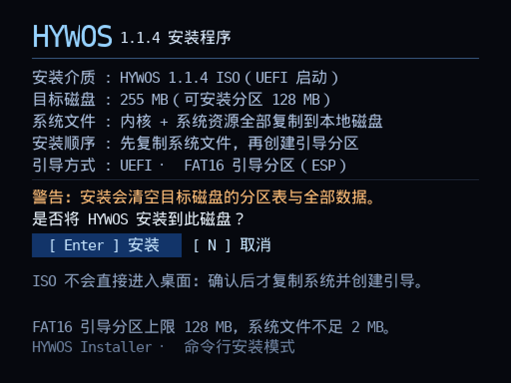 |

| 安装进度 | 安装完成 |
|---|---|
|  |  |

| 桌面 | 启动台 |
|---|---|
|  |  |

| 设置 · 权限 | 设置 · 软件更新 |
|---|---|
|  |  |

| 应用商店 | 天气 |
|---|---|
|  | 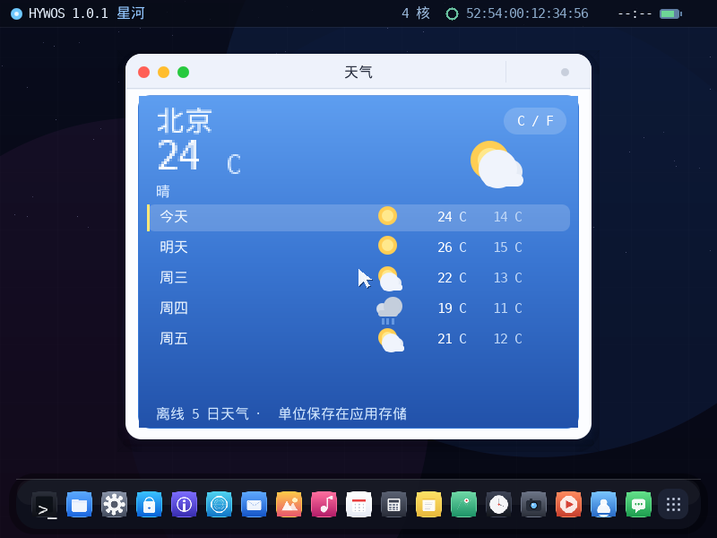 |

| 关于本机 | 终端 |
|---|---|
|  |  |

| 终端 · net | 终端 · ping |
|---|---|
| 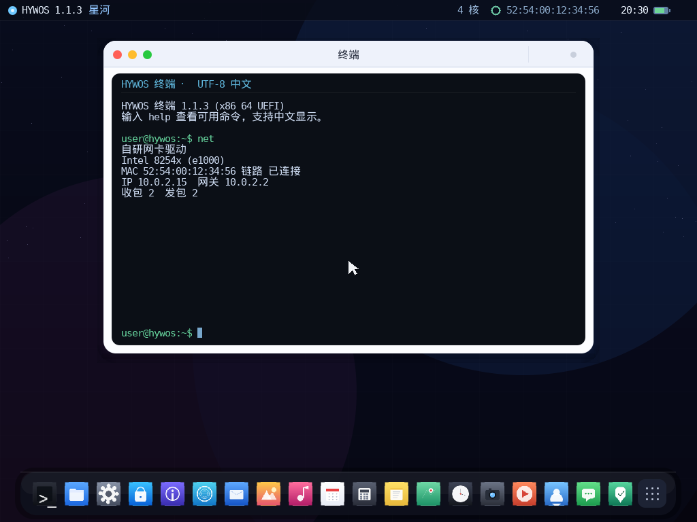 |  |

| 终端 · Ring3 | 终端 · 页表隔离 |
|---|---|
|  |  |

| 终端 · 宏内核子系统 |
|---|
| 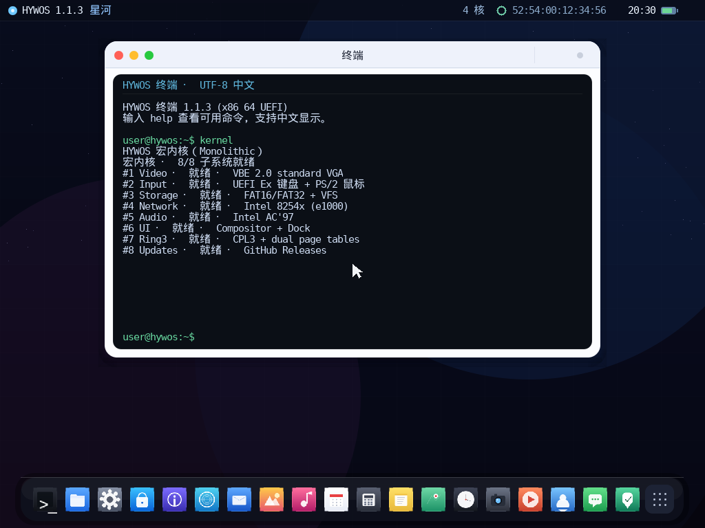 |

| 文件 | 安全中心 |
|---|---|
| 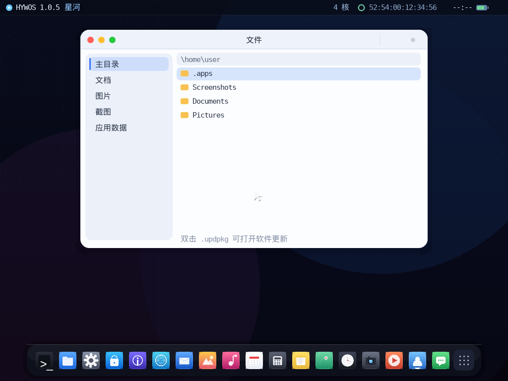 |  |

| 浏览器 | 邮件 |
|---|---|
|  | 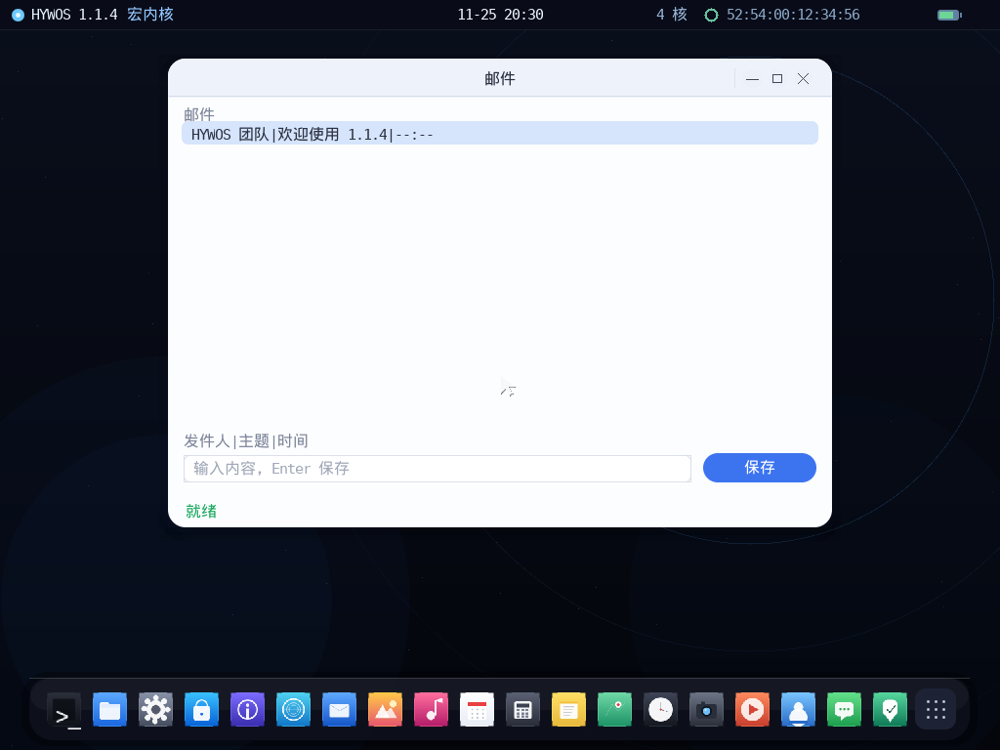 |

| 照片 | 视频 |
|---|---|
| 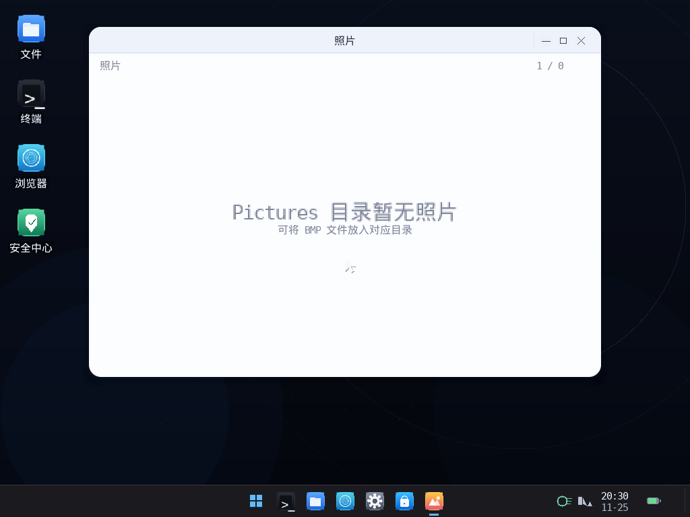 | 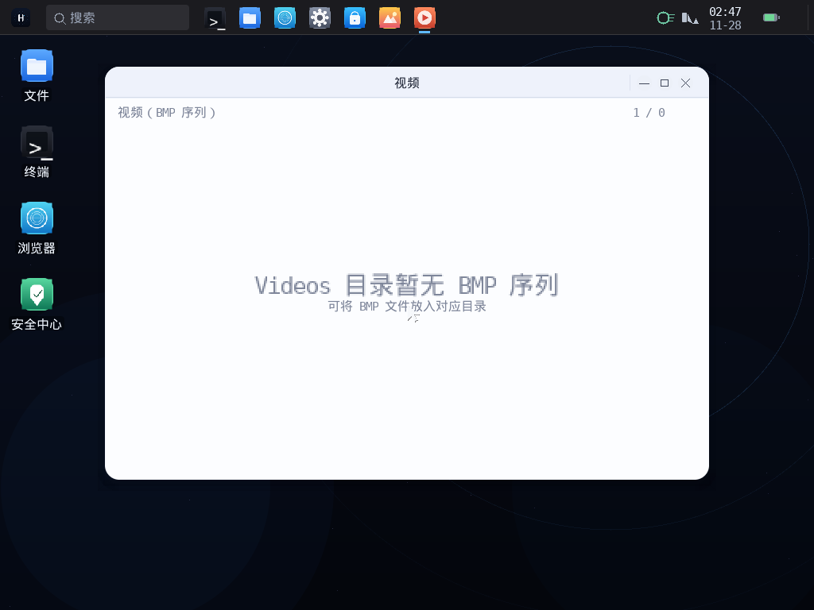 |

| 音乐 | 日历 |
|---|---|
|  |  |

| 计算器 | 备忘录 |
|---|---|
| 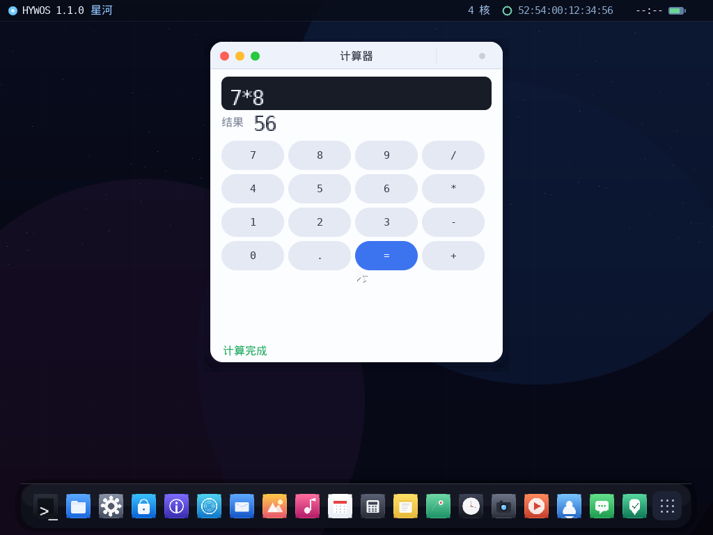 |  |

| 地图 | 时钟 |
|---|---|
|  | 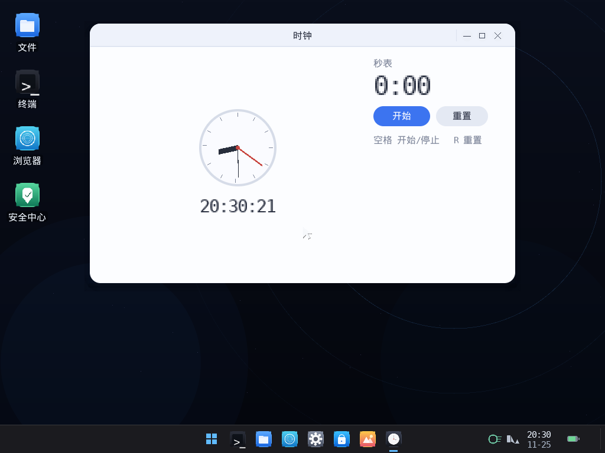 |

| 相机 | 通讯录 |
|---|---|
| 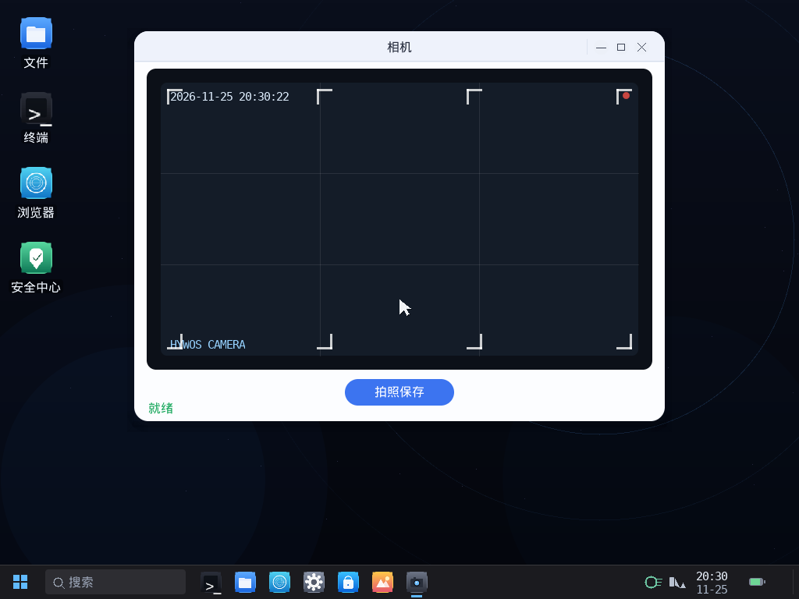 |  |

| 信息 |
|---|
|  |

截图由 QEMU 11.1.3 运行 HYWOS 1.1.0 生成，通过 VNC 抓取 framebuffer 原始画面，未做修图。

## 版本历史

| 版本 | 主题 | 发布 |
|---|---|---|
| 1.1.3 | 宏内核子系统与统一内核 API | [Release](https://github.com/lmxdg/HYWOS/releases/tag/v1.1.3) |
| 1.1.2 | Ring3 用户态与双页表 | [Release](https://github.com/lmxdg/HYWOS/releases/tag/v1.1.2) |
| 1.1.1 | 自研网卡驱动与 ARP/ICMP | [Release](https://github.com/lmxdg/HYWOS/releases/tag/v1.1.1) |
| 1.1.0 | 全应用可用、安全中心、LOGO 淡入 | [Release](https://github.com/lmxdg/HYWOS/releases/tag/v1.1.0) |
| 1.0.8 | 高分辨率显示、PS/2 重写、USB HID | [Release](https://github.com/lmxdg/HYWOS/releases/tag/v1.0.8) |
| 1.0.7 | 安装检测、安装流程、在线更新 | [Release](https://github.com/lmxdg/HYWOS/releases/tag/v1.0.7) |
| 1.0.6 | 安装进度条 | [Release](https://github.com/lmxdg/HYWOS/releases/tag/v1.0.6) |
| 1.0.5 | 硬盘检测、4Kn | [Release](https://github.com/lmxdg/HYWOS/releases/tag/v1.0.5) |
| 1.0.4 | ISO 安装介质、FAT16 引导 | [Release](https://github.com/lmxdg/HYWOS/releases/tag/v1.0.4) |
| 1.0.3 | 粒子动画、现代输入 | [Release](https://github.com/lmxdg/HYWOS/releases/tag/v1.0.3) |
| 1.0.2 | 显卡/PS2/声卡驱动 | [Release](https://github.com/lmxdg/HYWOS/releases/tag/v1.0.2) |
| 1.0.1 | 中文界面与 UI 重绘 | [Release](https://github.com/lmxdg/HYWOS/releases/tag/v1.0.1) |
| 1.0.0 | 首个版本 | [Release](https://github.com/lmxdg/HYWOS/releases/tag/v1.0.0) |

## 现实边界

- 网络：自研驱动提供二层收发与 ARP/ICMP；内核仍不含 TCP/UDP 传输层，
  浏览器与在线更新依赖固件 `EFI_HTTP_PROTOCOL`（含 TLS）。
- 邮件、信息：本地记录与撰写，不连接 SMTP/短信网关。
- 视频：播放 BMP 序列，不含 H.264/H.265 解码。
- 相机：采集当前合成画面，不含 USB 摄像头驱动。
- 病毒库：需用户提供 `VIRUS.DB`；仓库不内置样本签名。
- 中文输入：显示完整，键盘输入为 ASCII；中文输入法不在范围内。
- 用户态：内置固定用户程序用于验证 Ring3/syscall/隔离，尚未实现 ELF 加载器与独立用户进程管理。
- 分辨率：软件合成上限 1920×1080。

## 开源协议

MIT License，见 [LICENSE](LICENSE)。
